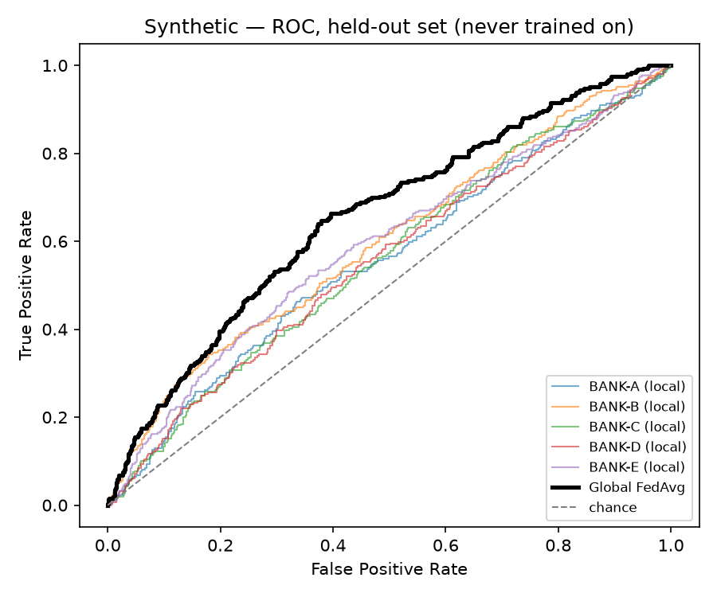
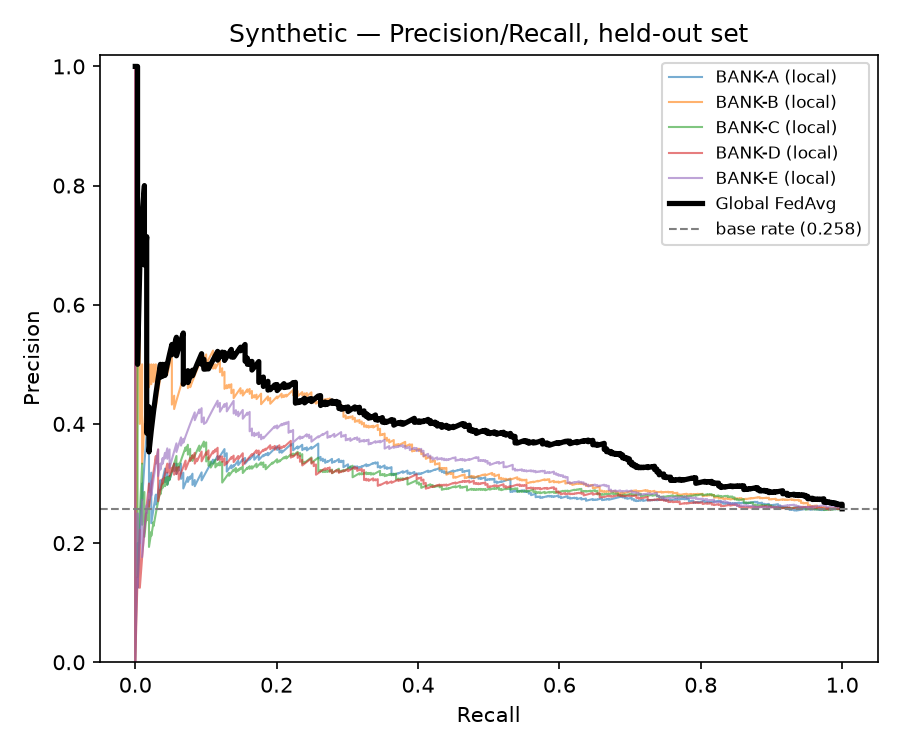
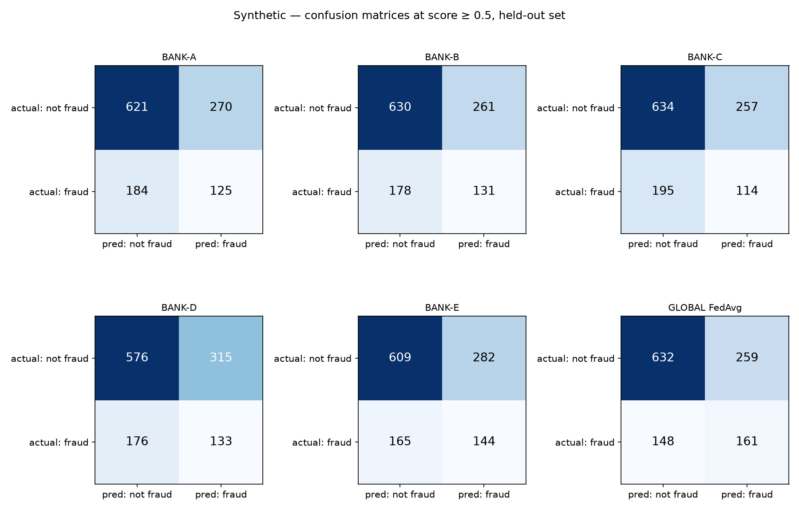
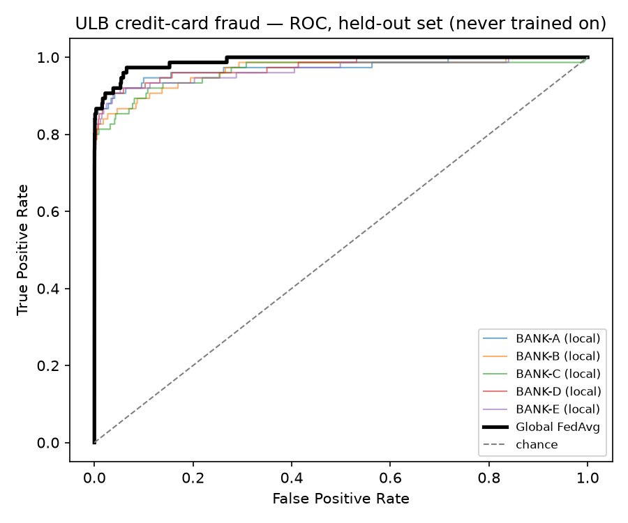
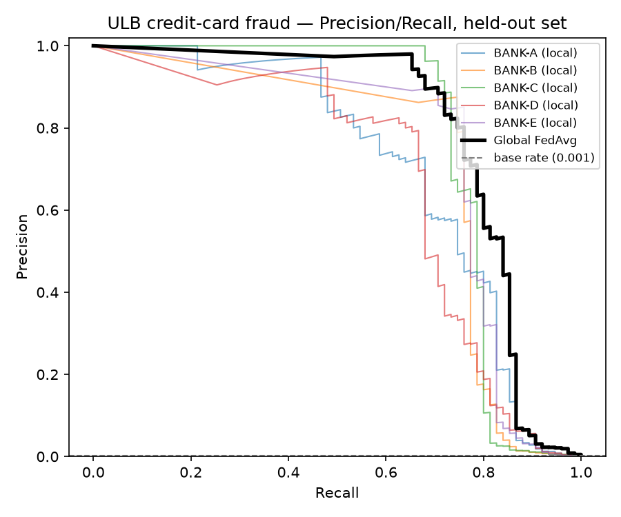
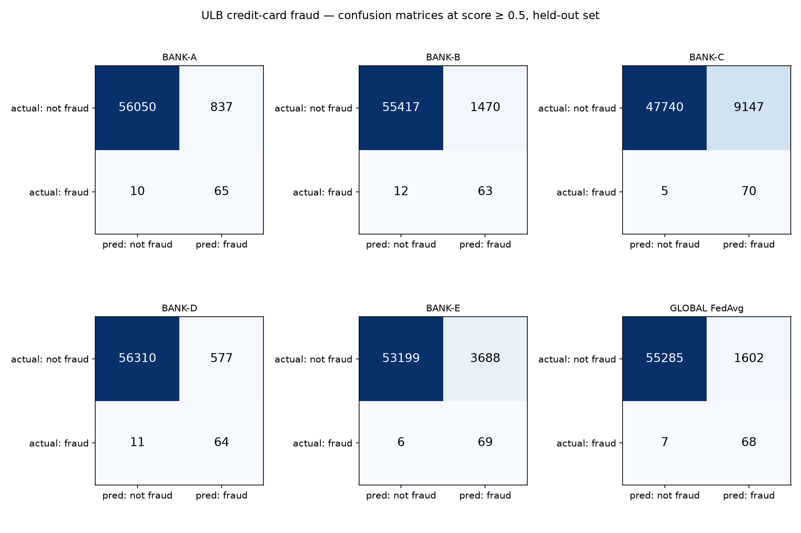

# Model metrics — every bank, the global model, both datasets

All numbers and curves on this page come from a real training run on this
machine, never hand-typed. Regenerate them yourself with:

```bash
pip install -e ".[dev,ml,viz]"

ARIS_SALT=$(python -c "import secrets;print(secrets.token_hex(32))") \
    python -m aris.fl.run --dataset synthetic
ARIS_SALT=$(python -c "import secrets;print(secrets.token_hex(32))") \
    python scripts/generate_metrics_report.py --dataset synthetic

ARIS_SALT=$(python -c "import secrets;print(secrets.token_hex(32))") \
    python -m aris.fl.run --dataset ulb --rounds 5 --epochs 2
ARIS_SALT=$(python -c "import secrets;print(secrets.token_hex(32))") \
    python scripts/generate_metrics_report.py --dataset ulb --rounds 5 --epochs 2
```

`aris.fl.run` writes the tables' numbers to `data/processed/m1_metrics_<dataset>.json`.
`generate_metrics_report.py` retrains the same split independently (never
reads that JSON) and renders the curves below — the two are cross-checked
against each other in the runbook, not assumed consistent.

All models are evaluated only on a holdout split carved out **before**
any bank's training client is constructed (`src/aris/fl/run.py`,
`pooled_holdout_from_shards` for synthetic / time-ordered cut for ULB) —
every number and every curve point on this page is unseen-data
performance, not training-set performance.

---

## Synthetic — 5 banks, 8 rounds × 4 local epochs

Each bank's fraud is driven by a different, otherwise-unused feature
(`f0`..`f4`); the holdout pools rows from all 5 banks, so no single bank's
local model ever saw the other 4 banks' fraud pattern. Fraud rate in the
holdout: 309/1200 (~25.8%).

| Model | AUC | PR-AUC | Precision @ 0.5 | Recall @ 0.5 | Accuracy @ 0.5 |
| --- | --- | --- | --- | --- | --- |
| BANK-A (local only) | 0.560 | 0.302 | 0.321 | 0.408 | 0.626 |
| BANK-B (local only) | 0.597 | 0.354 | 0.339 | 0.427 | 0.638 |
| BANK-C (local only) | 0.560 | 0.300 | 0.308 | 0.369 | 0.624 |
| BANK-D (local only) | 0.555 | 0.298 | 0.296 | 0.427 | 0.591 |
| BANK-E (local only) | 0.589 | 0.329 | 0.342 | 0.476 | 0.629 |
| Mean of 5 local models | 0.572 | 0.316 | 0.321 | 0.421 | 0.622 |
| **Global FedAvg** | **0.655** | **0.392** | **0.383** | **0.521** | **0.661** |

Precision/Recall are at the same fixed 0.5 score threshold as accuracy —
see `src/aris/fl/metrics.py`. Recall @ 5% FPR (0.088 mean-local / 0.155
global) and FPR @ 50% recall (0.390 mean-local / 0.277 global) are also
computed and stored in `m1_metrics_synthetic.json` for every model; omitted
here to keep the table readable — they don't change the story the curves
already tell below.

<p float="left">
  
  
</p>

**What the curves show that the table alone doesn't:** the global FedAvg
line (bold black) sits above every single bank's local curve across almost
the entire ROC and PR range — not just in the summary AUC number. This is
the direct visual evidence for why federation helps here: each bank alone
only has one weak feature's worth of signal, and combining all 5 banks'
updates (without any bank ever seeing another's raw rows) recovers the
signal no individual bank could see on its own.

**Confusion matrices** (at the same 0.5 threshold, 1200-row holdout, 309
actual fraud):



The global model catches the most fraud of any of the six (161 true
positives vs. 114-147 for individual banks) while also cutting false
positives relative to most of them (259, in the middle of the 256-314
range banks show individually) — consistent with the precision *and*
recall both improving over the local mean in the table above, not a
trade-off in either direction.

---

## ULB credit-card fraud — 5 banks, temporal shards, 5 rounds × 2 epochs

Real, PCA-anonymized transaction data: the full published dataset, 284,807
transactions over two days, 492 of them fraud. Banks are split by **time
window**, not by identity — each bank trains on a different slice of the
timeline, and the holdout is the most recent 20% of time, unseen by any bank
during training: 56,962 rows, 75 fraud (0.13%). Predicting "not fraud" for
every row would already score 99.87% accuracy here.

**Correction (October 2026).** An earlier version of this section reported
global AUC 0.990 and PR-AUC 0.926 from a truncated download (89,900 of the
284,807 rows) further capped to 30k rows keeping every fraud — a fraud rate
roughly 10x the real one, which inflated PR-AUC and precision. The loader now
refuses incomplete files and the numbers below use the full, uncapped data.

| Model | AUC | PR-AUC | Precision @ 0.5 | Recall @ 0.5 | Accuracy @ 0.5 |
| --- | --- | --- | --- | --- | --- |
| BANK-A (local only) | 0.972 | 0.708 | 0.072 | 0.867 | 0.985 |
| BANK-B (local only) | 0.966 | 0.675 | 0.041 | 0.840 | 0.974 |
| BANK-C (local only) | 0.963 | 0.774 | 0.008 | 0.933 | 0.839 |
| BANK-D (local only) | 0.975 | 0.657 | 0.100 | 0.853 | 0.990 |
| BANK-E (local only) | 0.966 | 0.709 | 0.018 | 0.920 | 0.935 |
| Mean of 5 local models | 0.969 | 0.704 | 0.048 | 0.883 | 0.945 |
| **Global FedAvg** | **0.990** | **0.793** | **0.041** | **0.907** | **0.972** |

Federation helps on real data too: the global model beats every bank's
local-only model on AUC and the local mean on PR-AUC (0.793 vs 0.704).

**Read the precision column carefully — this is the honest part.** Every
model's precision at a fixed 0.5 threshold is low (0.008–0.100) despite AUC
near 0.97–0.99. That is what a 0.13%-fraud problem does at a blanket
threshold: even a small false-positive *rate* produces far more
false-positive *rows* than there are fraud rows. AUC and PR-AUC sweep every
threshold and are the metrics that matter here; a real deployment tunes the
threshold against the cost of a missed fraud versus a false alarm.

<p float="left">
  
  
</p>

**Is 0.99 AUC overfitting?** No — checked directly, not assumed. The same
global model scored against the 227,845 *training* rows it did see gets AUC
0.992; against the 56,962-row *holdout* it never saw, 0.990. A 0.002 gap is
what genuine generalization looks like — overfitting would show up as a large
gap. ULB's `V1`-`V28` PCA features are known to be highly separable for fraud;
published results on this dataset routinely report AUC in the 0.95–0.99 range
with standard models.

**Confusion matrices** (same 0.5 threshold, 56,962-row holdout, 75 actual
fraud):



The global model catches 68 of the 75 frauds with 1,602 false alarms among
56,887 legitimate rows (a 2.8% false-positive rate). Individual banks range
from 577 false alarms (BANK-D, catching 64) to 9,147 (BANK-C, catching 70) —
one bank's model alone is either noticeably less sensitive or far noisier.

---

## Why AUC/PR-AUC lead, and accuracy/precision/recall are secondary

Both datasets are imbalanced (26% and 0.13% fraud respectively). A model
that predicts "not fraud" for every row scores ~74% and ~99.9% accuracy on
them respectively while catching zero fraud — so accuracy alone can look
good while being useless. Precision and recall are more honest but are
tied to one arbitrary threshold (0.5 here); ULB's low precision numbers
above are a direct symptom of that (see the confusion-matrix section).
AUC and PR-AUC sweep every threshold at once and don't have either failure
mode, which is why they're reported first on this page. See
`src/aris/fl/metrics.py`.

## Reproducibility notes

- Every number and curve above was generated on this machine, on the
  commit these docs ship with — see `docs/REVIEW_RUNBOOK.md` section 3 for
  the exact commands to run live in front of a reviewer.
- `scripts/generate_metrics_report.py` retrains local baselines and the
  federated model independently of `python -m aris.fl.run`, using the same
  `TrainConfig` defaults and the same partition/holdout logic
  (`src/aris/fl/partition.py`) — the two paths agreeing (see the
  cross-check line each run prints) is itself evidence the split is
  deterministic and leakage-free, not just an assertion.
- The `viz` extra (`matplotlib`) is only used by this report script; it is
  never imported by `src/aris` itself.
